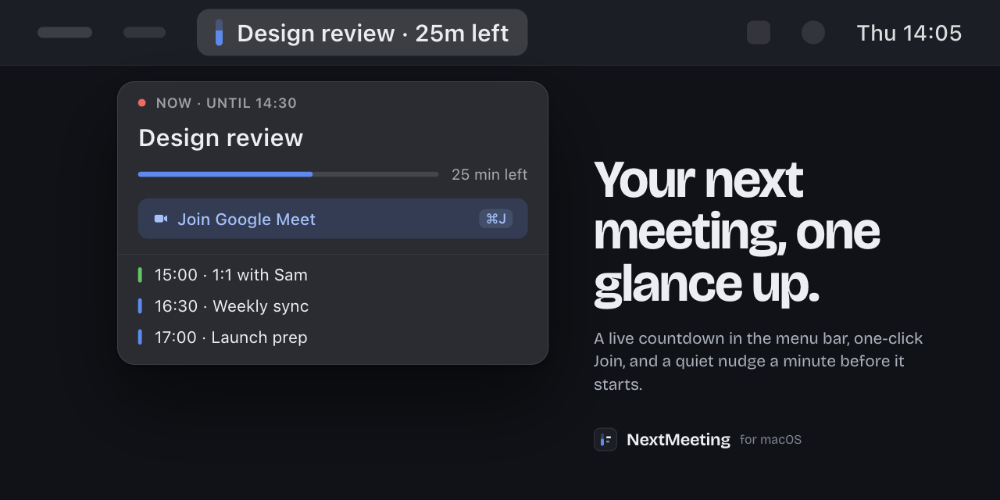
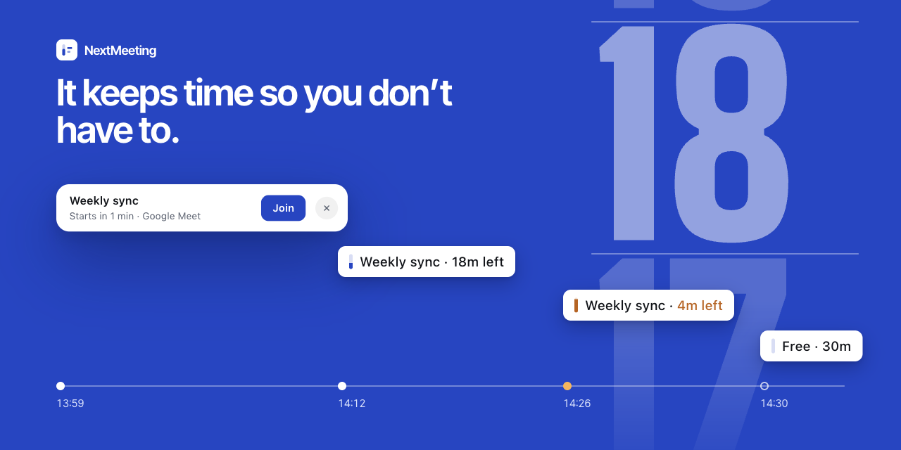
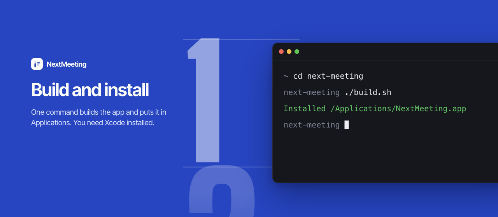
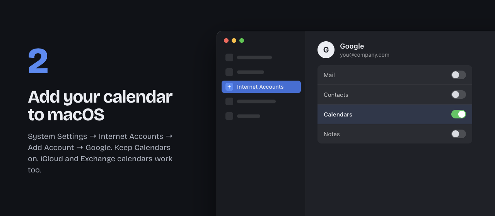
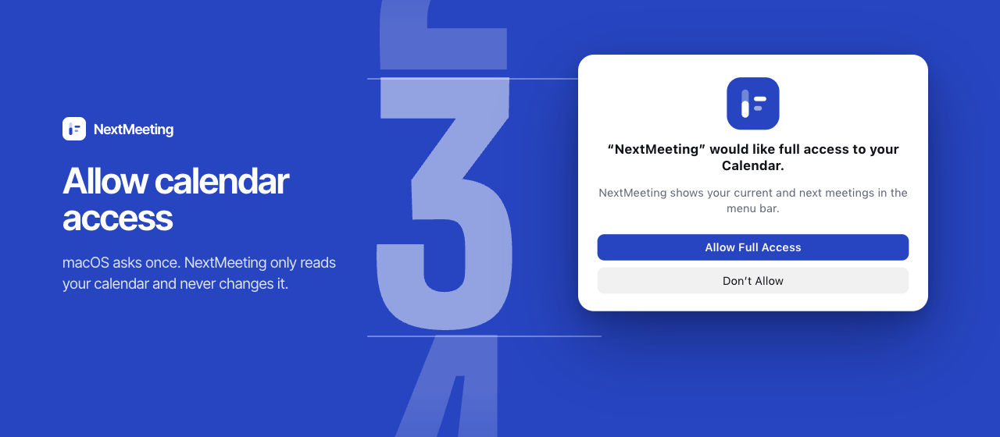
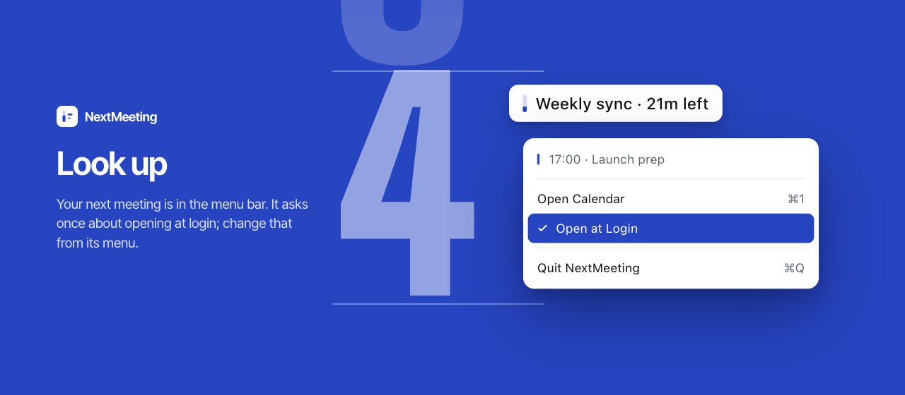

<p align="center"></p>

# NextMeeting

A small native Mac app that keeps your current or next meeting in the menu bar. It shows a live countdown, puts the call link one click away, and slides down a reminder a minute before each meeting starts.

It reads the calendars you've already added to macOS (Google, iCloud, Exchange). There's no account to create and nothing to sign in to.

<p align="center"></p>

## What it does

- **Menu bar countdown.** `Weekly sync · 18m left` during a meeting, `in 12m` before the next one. The small bar next to it fills up as the meeting goes on and turns orange in the last 5 minutes.
- **Now card.** Opening the menu shows the meeting you're in, how far through it you are, and a Join button. `⌘J` joins while the menu is open.
- **One-minute reminder.** A card slides down from the menu bar with Join and dismiss buttons. It stays until you join, dismiss it, or 5 minutes after the start, so you can still catch it if you're late. Meetings that start together stack.
- **Rest of today and tomorrow** in the menu, with all-day events, calendar colours, and invites you haven't answered marked ⚠︎. Declined and cancelled meetings are hidden.
- **Join links** for Google Meet, Zoom, Microsoft Teams, Webex and Slack huddles, found in the event's URL, location or notes.

## Setup



You need Xcode (or the Xcode command line tools) on macOS 14 or later.

```bash
./build.sh
```

It builds `NextMeeting.app`, signs it for this Mac, copies it to `/Applications` and opens it.



Open **System Settings → Internet Accounts → Add Account → Google**, sign in, and keep **Calendars** on. iCloud and Exchange calendars work the same way.



The first time it runs, macOS asks for calendar access. Click **Allow Full Access**. NextMeeting only reads your calendar and never changes it.



That's it. NextMeeting asks once whether to open at login. Change that any time with **Open at Login** in its menu.

## Notes

- **macOS asks for calendar access again after a rebuild.** The app is signed only for this Mac, so each rebuild looks like a new app to macOS.
- **To preview the reminder**, quit NextMeeting first, then run:

  ```bash
  open /Applications/NextMeeting.app --args --test-reminder
  ```

- **To uninstall**, quit it from its menu and move `/Applications/NextMeeting.app` to the Trash.

## Files

| File | What it is |
|---|---|
| `main.swift` | Menu bar item, menu, reminders, calendar reading |
| `views.swift` | The now card and the reminder card (SwiftUI) |
| `Info.plist` | App name, bundle id, calendar permission text |
| `build.sh` | Build, sign, install, open |
| `docs/` | README images, made from `docs/src/*.html` |

## License

MIT. See [LICENSE](LICENSE).
